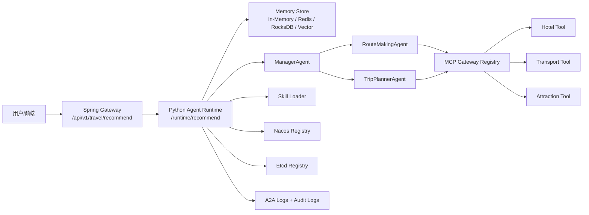
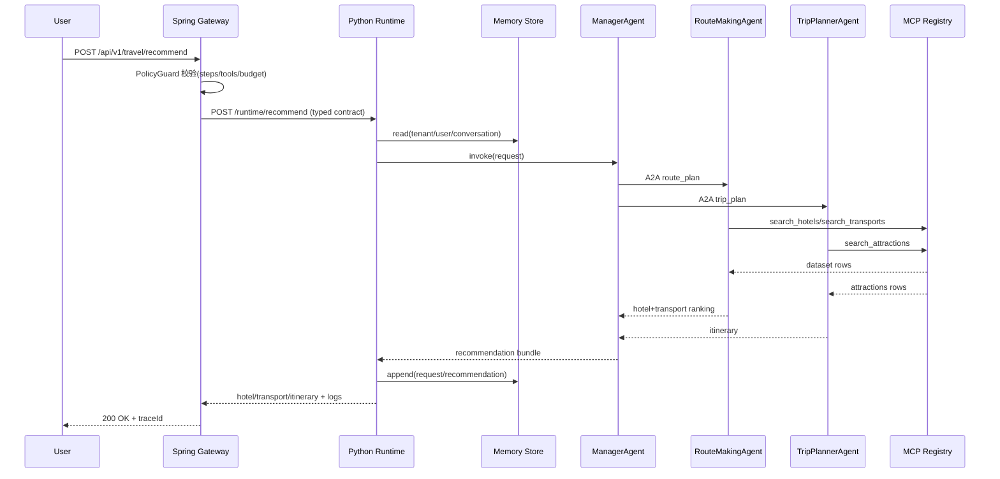
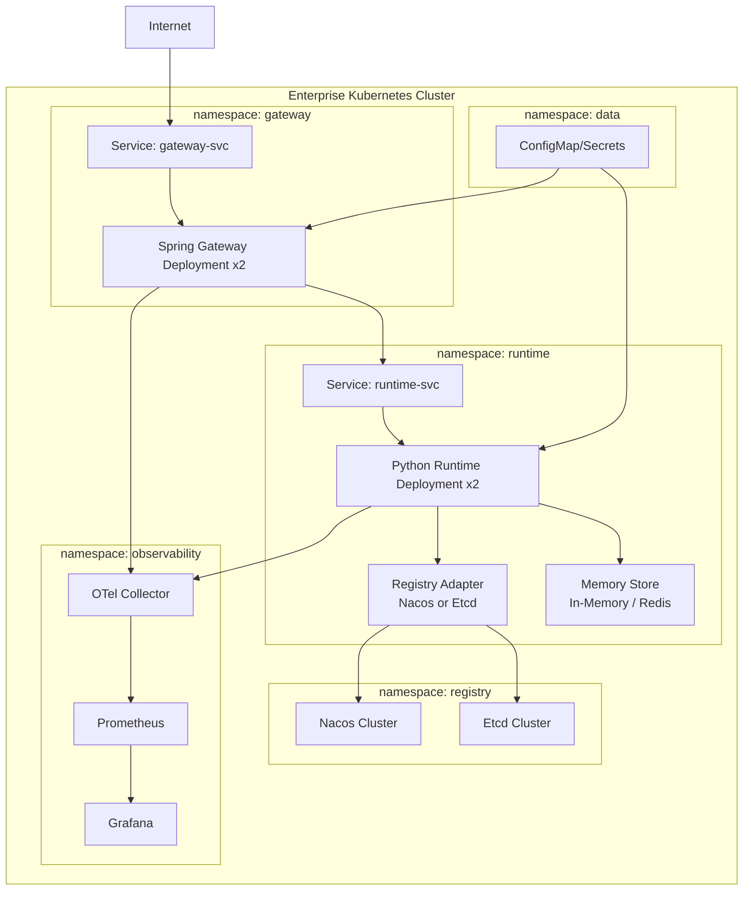

# 企业级智能旅游推荐智能体课程级交付文档（图文并茂）

## 0. 教学目标

本课程交付面向“高职高专 AI 专业实战教学 + 企业工程化能力训练”，目标是让学生完成：

1. 分布式多Agent系统架构理解与搭建
2. MCP 工具治理与 Skills 动态加载
3. Spring 网关 + Python 运行时混合部署
4. 可测试、可观测、可运维的工程落地

运行环境升级基线：

- Python 3.12+
- FastAPI 0.135.2 + Uvicorn 0.42.0 + Pydantic 2.12.0

---

## 1. 总体架构图（Mermaid）



---

## 2. 时序图（请求到推荐输出）



---

## 3. 部署拓扑图（生产建议）



---

## 4. 评分矩阵（框架选型）

| 维度 | 权重 | LangGraph | Spring AI Alibaba | AgentScope-AI | JoyAgent | OneAgent |
|---|---:|---:|---:|---:|---:|---:|
| 工作流编排与状态控制 | 0.20 | 9 | 7 | 8 | 7 | 2 |
| MCP/工具互操作 | 0.20 | 8 | 8 | 8 | 7 | 3 |
| Skills 扩展治理 | 0.15 | 8 | 8 | 8 | 8 | 2 |
| 可观测与审计 | 0.15 | 8 | 8 | 7 | 7 | 10 |
| 企业部署与治理 | 0.15 | 7 | 9 | 7 | 8 | 9 |
| Java/Python 生态适配 | 0.10 | 8 | 9 | 7 | 8 | 8 |
| 教学可实现性 | 0.05 | 9 | 8 | 8 | 7 | 5 |
| 加权总分 | 1.00 | **8.2** | **8.2** | 7.7 | 7.4 | 4.8 |

> 结论：课程与企业双场景建议“**Spring AI Alibaba + LangGraph 思路混合**”，OneAgent 作为观测补充层。

---

## 5. 课程案例附录

### 案例A：亲子家庭游（预算优先）

- 输入：北京、3天、预算3000、2人、偏好 family + budget
- 输出：
  - 酒店：北京家庭轻居酒店
  - 交通：高铁二等座
  - 行程：故宫/颐和园/环球影城
- 教学点：Skills 权重如何影响排序

### 案例B：商务出行（舒适优先）

- 输入：上海、2天、预算4000、1人、偏好 comfort
- 输出：
  - 酒店：高评分舒适型优先
  - 交通：高时效方案优先
- 教学点：策略约束与解释性推荐

### 案例C：策略违规拦截

- 输入：allowedTools 缺少核心工具
- 输出：网关返回 POLICY_VIOLATION
- 教学点：网关治理与 fail-closed

### 案例D：注册中心切换实验

- 操作：`TRAVEL_REGISTRY=nacos-real` 与 `TRAVEL_REGISTRY=etcd-real` 切换
- 观察：`registered_agents` 与 `registered_tools` 的一致性
- 教学点：服务发现抽象与可替换基础设施

### 案例E：A2A 协议互通实验

- 操作：调用 `/a2a/send` 与 `/a2a/inbox/{receiver}`
- 观察：消息 topic、payload、receiver 收件箱状态
- 教学点：Agent 间协议通信与可追踪协同

### 案例F：记忆存储实验

- 操作：同一 `tenantId/userId/conversationId` 连续两次调用 `/runtime/recommend`
- 观察：响应中的 `memory_before/memory_after` 长度变化
- 教学点：对话记忆的读取/写回与隔离策略

### 案例G：向量记忆检索实验

- 操作：`TRAVEL_MEMORY_BACKEND=vector`，查询同一会话下不同城市请求
- 观察：`memory_hits` 与 `city` 关键词相关度
- 教学点：语义检索与消息历史读写语义分离（read vs query）

### 案例H：Etcd 客户端双栈迁移实验

- 操作：`TRAVEL_ETCD_CLIENT_MODE=legacy/new/auto` 分别运行
- 观察：服务注册、发现、工具目录一致性
- 教学点：客户端迁移的兼容策略与灰度切换

### 案例I：迁移演练脚本 + Canary报告

- 操作：运行 `stress/etcd_migration_drill.py` 对 legacy/new 两套环境并行采样
- 观察：`success_rate`、`p95/p99`、`registered_agents/tools` 一致性与差异
- 产物：`stress/etcd_migration_compare.json` + `stress/etcd_canary_report.md`
- 教学点：证据驱动的发布门禁（Promote / Hold / Rollback）

---

## 6. 教学实施建议

1. 第1周：需求分析 + 架构图绘制
2. 第2周：MCP 工具层与 Skills 机制实现
3. 第3周：Spring 网关接入 + 跨服务契约
4. 第4周：测试、部署、观测与答辩

---

## 8. 分布式追踪与安全控制（升级版）

### 8.1 Trace 透传规范

- 外部调用可带 `X-Trace-Id`
- Gateway 将 `X-Trace-Id` 透传到 Python Runtime
- Gateway 同时注入 `traceparent` 头（W3C Trace Context 形式）
- Runtime 响应中返回 `trace_id`，用于审计关联

### 8.2 内部安全控制（教学版）

- 模拟 mTLS 身份头：`X-Internal-Client-Id`
- 模拟内部签名：`X-Internal-Signature = SHA256(idempotencyKey + "." + sharedSecret)`
- Runtime 验证失败时直接拒绝（fail-closed）

### 8.3 课程实验建议

1. 正常请求（合法 trace + client + signature）
2. 缺失 traceId（应被拒绝）
3. clientId 错误（应被拒绝）
4. signature 错误（应被拒绝）

### 8.4 风险与生产替换

- 当前签名是教学简化版
- 生产建议替换为：
  - mTLS 双向证书
  - JWT/OIDC 短期令牌
  - OpenTelemetry Collector + Jaeger/Tempo 全链路

---

## 7. 验收清单

- [ ] 有可运行的推荐 API
- [ ] 有 A2A 与 MCP 审计日志
- [ ] 有至少 3 个 Skills 并可动态影响推荐
- [ ] 有单元测试与接口测试
- [ ] 有 Docker/K8s 部署文件
- [ ] 有架构图、时序图、拓扑图、评分矩阵、案例附录

---

## 9. Spring AI Alibaba 升级说明（本项目）

### 9.1 已接入组件

- `spring-ai-alibaba-agent-framework`
- `spring-ai-alibaba-starter-dashscope`
- `ChatClient.Builder`（用于推荐解释增强）

## 10. MCP / Registry / A2A 实施说明

- MCP 工具：运行时注册 + 审计日志
- Registry：默认真实 Nacos/Etcd，支持内存模拟降级
- A2A：支持标准消息对象 + 路由投递 + inbox 查询
- Memory：支持内存/Redis/RocksDB/Vector 后端与严格启用语义

## 11. 企业级容量结论（必须实话实说）

- “支持 1M 并发 / 1亿用户”属于系统级能力声明，必须基于**分布式压测与生产流量验证**。
- 本项目已完成：
  - 真实 Nacos/Etcd 接入路径
  - 本地压测脚本与报告机制
  - 可扩展部署模板（K8s + HPA）
- 仍需在多节点环境完成最终容量认证：
  - 连接风暴测试
  - 跨可用区压测
  - 下游配额与降级策略验证

### 企业级上线流程补充

- CI/CD 自动质量门禁（Python + Java 测试）
- 金丝雀发布与自动回滚阈值
- 持续压测与SLO观测看板

### 已完成本地压测基线（用于授课演示）

- 1000 请求 / 并发100：成功率 100%，p99 184.86ms
- 5000 请求 / 并发300：成功率 100%，p99 521.44ms

课堂建议：

- 先演示本地压测方法与报告解读
- 再讲“为什么这不足以证明1M并发”
- 最后引出分布式压测设计与企业级容量认证流程

## 12. 面向公开分享的亮点表达

- 技术亮点：Spring AI Alibaba + MCP + Skills + Registry + A2A 一体化
- 工程亮点：真实注册中心接入路径 + 灰度发布 + 容量证据链
- 教学亮点：从“能跑”到“能上线”的完整方法论

### 9.2 关键配置

```yaml
spring:
  ai:
    dashscope:
      api-key: ${AI_DASHSCOPE_API_KEY:}
```

### 9.3 教学提示

- 未配置 API Key 时，系统自动回退到本地解释策略，保证课堂可离线演示。
- 配置真实 Key 后，可演示“同一推荐结果 + 不同大模型解释风格”的对比实验。
