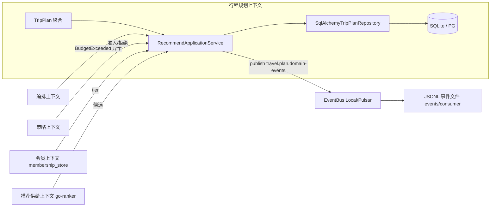

# DDD 事件风暴与 TripPlan 仓储持久化（Gap2）

> 状态：落地中（2026-09-20）。本文档基于当前代码逐事件核对现状，
> 未实现的事件在"现状"列如实标注，不做虚报。

## 1. 事件风暴概览

限界上下文（Bounded Context）划分：

| 上下文 | 代码位置 | 职责 |
| --- | --- | --- |
| 行程规划（Trip Planning） | `src/travel_agent/domain/travel.py`、`application/recommend_service.py` | TripPlan 聚合根、推荐候选挂接、行程确认 |
| 编排（Orchestration） | `orchestration/engine.py`、`orchestration/budget.py` | 流水线阶段调度、执行预算扣减 |
| 策略（Policy） | `data-contracts/policy-core/policy-core.v1.json` + go-policy / Java PolicyCoreSpec（见 ADR-0004） | 请求准入与阈值判定 |
| 会员（Membership） | `membership_store.py` | 会员等级读写（内存 + Redis 双实现） |
| 推荐供给（Recommendation） | `recommendation/`、go-ranker | 候选打分与召回 |
| 事件外送（Event Publication） | `events/bus.py`、`events/consumer.py`、`application/recommend_service.py` | 领域事件经 EventBus 发布、JSONL 落盘 |

## 2. 命令与事件流

```
用户提交规划请求 (Command: PlanTrip)
  -> RecommendApplicationService.plan_trip()
     -> 构造 TripPlan 聚合            ⇒ 领域事件 TripPlanCreated
     -> attach_options() 挂接候选     ⇒ 领域事件 TripPlanOptionsAttached
     -> repository.save(plan)          （SQLite/SQLAlchemy 仓储，新增）
     -> event_bus.publish(travel.plan.domain-events, 逐事件外送）
```

## 3. 领域事件清单（含现状）

| 事件 | 触发点 | 载荷 | 现状 |
| --- | --- | --- | --- |
| `TripPlanCreated` | `TripPlan.__post_init__`（仅当 `events` 为空，防重放水合重复记录） | 城市天数预算人数等 | **已实现**，随持久化接线经 EventBus 外送 |
| `TripPlanOptionsAttached` | `TripPlan.attach_options()` | hotels/transports 数量 | **已实现**，同上 |
| `TripPlanConfirmed` | `TripPlan.confirm()` | plan_id | 已在聚合内记录；尚无外送接线（事件仍随 save 全量外送，见 §5） |
| `BudgetExceeded` | `orchestration/budget.py` 执行预算耗尽时抛出（异常，非聚合事件） | 已用/上限 | **异常机制已实现**；未转成领域事件外送 |
| `PolicyDenied` | go-policy / 策略引擎拒绝请求 | 拒绝原因 | 策略拒绝存在（HTTP 4xx），**无领域事件** |
| `RecommendationAccepted` | 用户确认推荐候选 | plan_id、选中项 | **未实现**（目前确认仅改状态） |
| `MembershipTierUpgraded` | 会员等级变更 | tenant/user/新等级 | **未实现**（membership_store 仅读写，不发事件） |

## 4. 聚合与不变量

TripPlan 聚合根（`domain/travel.py`）不变量：

- `Budget` 为 frozen 值对象，`amount > 0`；
- `TripPlanCreated` 恰好记录一次（重放水合不重复）；
- 候选必须通过 `attach_options()` 挂接，字段为 `hotel_options` /
  `transport_options` / `itinerary`；
- 事件列表为 `List[Dict[str, str]]`，聚合内追加，仓储保存时随行。

仓储（`infrastructure/repositories.py` `SqlAlchemyTripPlanRepository`）：

- `save()` 先镜像内存，再经 `_BackgroundLoopRunner`（专用守护线程 +
  asyncio loop）异步落库，超时 `TRAVEL_PLAN_DB_TIMEOUT_S`（默认 30s）；
- `get()` / `list_by_city()` 在 DB 异常时**降级为内存镜像**（告警日志）；
- ORM 与聚合的转换在 `db/crud.py`（ORM 类别名 `TripPlanORM`，避免与
  领域 `TripPlan` 同名遮蔽——此遮蔽 bug 即本 Gap 新增集成测试曝光并修复）。

## 5. 上下文映射（Mermaid）



## 6. 后续演进项（如实列出，不在本 Gap 内承诺）

- `PolicyDenied` / `RecommendationAccepted` / `MembershipTierUpgraded`
  事件化与外送；
- `BudgetExceeded` 由异常升级为领域事件；
- 事件表独立持久化（当前事件随聚合 JSON 列一并存储，重放依赖
  `TripPlanCreated` 去重守卫）。
