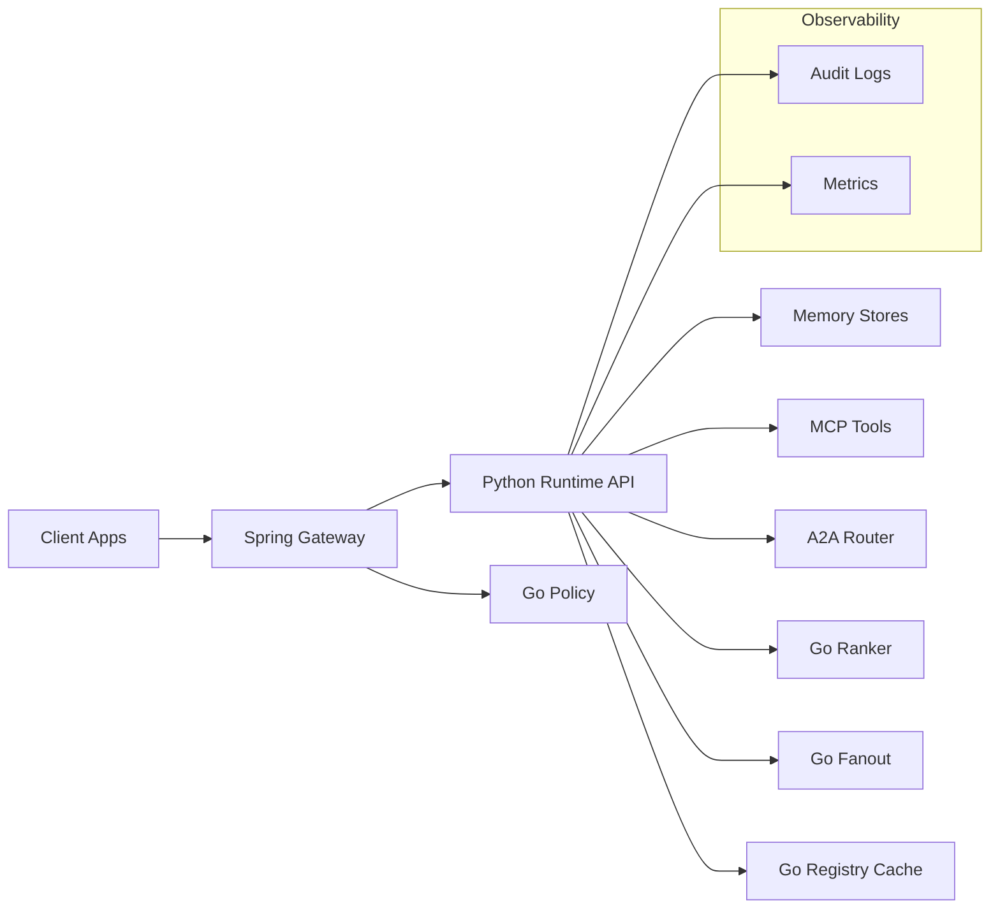
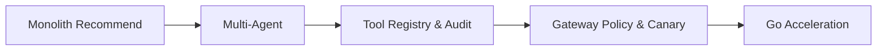
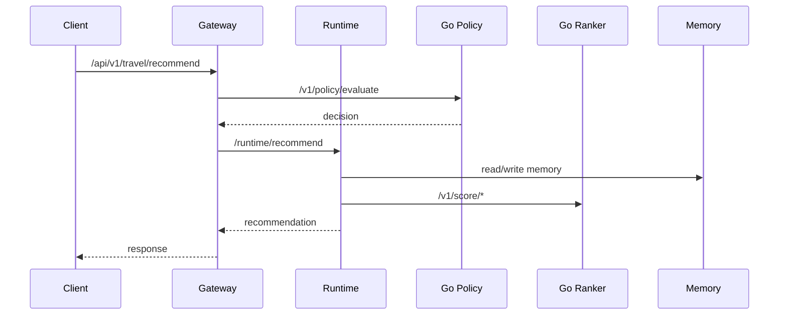

# Developer API Manual (English)

Version: 2026-03-30

## 1. Overview

This manual describes service boundaries, API contracts, configuration, and governance. Module-level annotations in source code are the authoritative implementation notes.

## 2. Architecture (Diagram)

## 2.1 Technology Choices & Boundaries

| Layer | Tech | Boundary |
| --- | --- | --- |
| Entry | Spring Gateway | Auth and policy gate |
| Orchestration | Python Runtime | Agents + tools |
| Acceleration | Go Services | scoring/policy/fanout |
| Observability | Prometheus | metrics and alerts |
| Storage | Redis/Qdrant | memory + vector recall |

## 2.3 Architecture Trade-offs

| Goal | Choice | Trade-off |
| --- | --- | --- |
| High-throughput scoring | Go Ranker | less flexibility for speed |
| Auditable policy | Gateway + Go Policy | more hops for governance |
| Fast iteration | Python Runtime | higher runtime overhead |

## 2.2 Architecture Evolution (Diagram)

## 3. Request Flow (Diagram)

## 3.1 Responsibility Boundaries

| Module | Boundary | Notes |
| --- | --- | --- |
| Gateway | policy/auth | unified entry and gatekeeping |
| Runtime | orchestration | itinerary and bundle generation |
| Go Policy | decision | high-performance policy eval |
| Go Ranker | scoring | hot-path acceleration |
| MCP Tools | data access | registry + audit |

## 3.2 Decision Records (Key Choices)

| Decision | Options Considered | Final Choice | Reason | Implementation |
| --- | --- | --- | --- | --- |
| Policy enforcement | Runtime-only vs Gateway + Go Policy | Gateway + Go Policy | governance and auditability | `services/techgroup-enterprise-travel-gateway/.../PolicyGuardService.java`, `services/techgroup-enterprise-travel-policy-go/main.go` |
| Scoring engine | Python only vs Go Ranker | Go Ranker | hot-path latency reduction | `services/techgroup-enterprise-travel-ranker-go/main.go` |
| Orchestration | LangGraph vs local | LangGraph default | mature ecosystem | `services/techgroup-enterprise-travel-runtime/src/travel_agent/orchestration/*` |
| Tool access | direct calls vs MCP registry | MCP registry | auditability | `services/techgroup-enterprise-travel-runtime/src/travel_agent/mcp/registry.py` |

## 4. API Catalog (Summary Table)

| Service | Port | Endpoint | Purpose |
| --- | --- | --- | --- |
| Runtime | 8000 | `POST /recommend` | Public recommend |
| Runtime | 8000 | `POST /runtime/recommend` | Internal recommend |
| Runtime | 8000 | `POST /a2a/send` | A2A send |
| Runtime | 8000 | `GET /a2a/inbox/{receiver}` | A2A inbox |
| Gateway | 8080 | `POST /api/v1/travel/recommend` | Enterprise entry |
| Go Ranker | 8090 | `POST /v1/score/hotel` | Hotel score |
| Go Ranker | 8090 | `POST /v1/score/transport` | Transport score |
| Go Policy | 8091 | `POST /v1/policy/evaluate` | Policy decision |
| Go Fanout | 8092 | `POST /v1/fanout/dispatch` | Concurrent fanout |
| Go Registry Cache | 8093 | `GET /v1/cache/get/{key}` | Registry cache read |

## 4.1 API Design Process (Steps)

1. Unified entry: gateway handles external requests.
2. Internal contract: runtime enforces trace/idempotency fields.
3. Policy-first: gateway evaluates policy before runtime.
4. Structured response: card-friendly fields for frontend.

## 4.2 Contract Decisions

| Field | Decision | Reason | Implementation |
| --- | --- | --- | --- |
| `X-Trace-Id` | required | observability and audit | `services/techgroup-enterprise-travel-runtime/src/travel_agent/api/app.py` |
| `idempotencyKey` | required | replay protection | `services/techgroup-enterprise-travel-runtime/src/travel_agent/traffic_guard.py` |
| `allowedTools` | required | policy enforcement | `services/techgroup-enterprise-travel-runtime/src/travel_agent/access/control.py` |

## 4.3 Implementation Evidence

Gateway Policy Guard:

Gateway Controller:

## 5. Runtime API Details (Python)

Base URL: `http://<runtime-host>:8000`

### 5.1 Public Recommend

- `POST /recommend`
  - Fields: `city, days, budget, travelers, preferences, membershipTier`
  - Returns: hotels, transport, itinerary, engagement recommendations

### 5.2 Internal Recommend

- `POST /runtime/recommend`
  - Headers: `X-Trace-Id`, `X-Internal-Client-Id`, `X-Internal-Signature`
  - Required fields: `tenantId, userId, conversationId, idempotencyKey`
  - Policy fields: `allowedTools, maxAgentSteps, maxToolCalls`
  - Returns: `memory_before/memory_after/memory_hits` + `audit_logs/a2a_logs`

### 5.3 A2A

- `POST /a2a/send`
- `GET /a2a/inbox/{receiver}`

## 5.5 Contracts & Data Models

- Core models: `services/techgroup-enterprise-travel-runtime/src/travel_agent/models.py`
- Policy contract: `data-contracts/policy-core/policy-core.v1.json`

## 5.6 Data Flow Evidence

Event Consumer:

## 5.4 Implementation Mapping (Evidence)

Runtime API:

Orchestrator:

Event consumer:

## 6. Go Service APIs

### 6.1 Go Ranker (8090)

- `POST /v1/score/hotel`
- `POST /v1/score/transport`

### 6.2 Go Policy (8091)

- `POST /v1/policy/evaluate`

### 6.3 Go Fanout (8092)

- `POST /v1/fanout/dispatch`

### 6.4 Go Registry Cache (8093)

- `GET /metrics`
- `GET /v1/cache/get/{key}`
- `POST /v1/cache/set`

## 7. Error Codes (Partial)

| Error | Scenario | Notes |
| --- | --- | --- |
| `missing X-Trace-Id` | Missing trace header | Runtime error |
| `untrusted internal client` | Client not allowlisted | Runtime error |
| `invalid internal signature` | Signature mismatch | Runtime error |
| `rate limit exceeded` | Rate limit hit | Runtime error |
| `duplicate submission` | Idempotency conflict | Runtime error |

## 8. Design Principles & Standards

### 8.1 Principles

- Single responsibility and replaceable components
- Degrade-first with fallback
- Audit-first and traceable

### 8.2 Patterns

- Strategy pattern (policy guard)
- Factory pattern (tool registry)
- Chain of responsibility (gateway checks)

### 8.3 Standards

- SLO/SLA metrics
- Security: least privilege, key rotation
- Globalization: multi-region data boundaries

## 8.4 Design Constraints (Summary)

- Fallback-first for dependency failures
- Audit required for all tool calls
- Policy enforcement cannot bypass the gateway

## 9. Security & Compliance

- Internal signature + client allowlist
- Auditable tool calls
- Fail-fast registry option in production

## 10. Observability

- Runtime audit logs + A2A logs
- Registry cache metrics endpoint
- Canary gate metrics

## 11. Performance & Scale

- Go Ranker for scoring throughput
- Go Fanout for high-concurrency dispatch
- Registry Cache to reduce registry latency

## 12. gRPC Fit Assessment

Recommended gRPC targets:

- Gateway -> Runtime (internal high QPS)
- Runtime -> Go Ranker / Go Policy (hot paths)

Not prioritized:

- Public Web/Miniapp interfaces

Detailed plan: `docs/grpc-migration-plan.en.md`

## 12.1 Implementation Evidence (Code Snapshots)

Runtime API:

Orchestrator:

Gateway Policy Guard:

Go Ranker:

## 13. Code Annotation Index (Mirrors Source)

### Python Runtime

- `services/techgroup-enterprise-travel-runtime/src/travel_agent/api/app.py`
- `services/techgroup-enterprise-travel-runtime/src/travel_agent/orchestrator.py`
- `services/techgroup-enterprise-travel-runtime/src/travel_agent/events/*`
- `services/techgroup-enterprise-travel-runtime/src/travel_agent/memory/*`
- `services/techgroup-enterprise-travel-runtime/src/travel_agent/tools/*`
- `services/techgroup-enterprise-travel-runtime/src/travel_agent/agents/*`

### Go Services

- `services/techgroup-enterprise-travel-ranker-go/main.go`
- `services/techgroup-enterprise-travel-policy-go/main.go`
- `services/techgroup-enterprise-travel-fanout-go/main.go`
- `services/techgroup-enterprise-travel-registry-cache-go/main.go`

