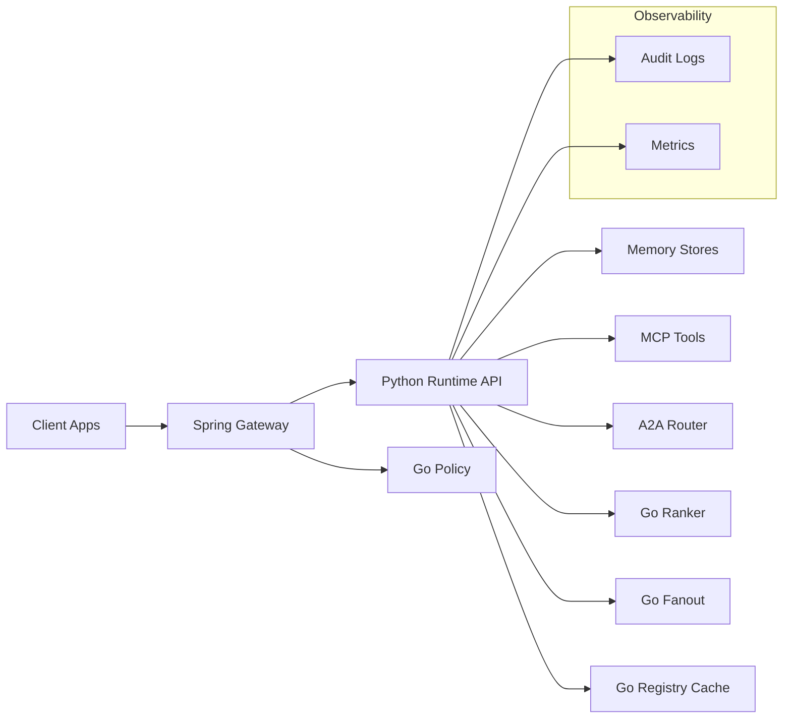
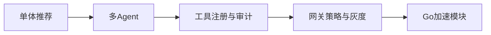
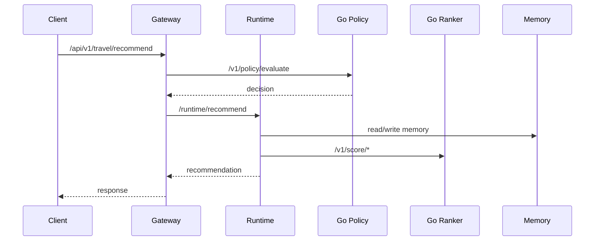

# 开发者 API 手册（中文）

版本：2026-03-30

## 1. 概览

本手册面向开发者，描述企业级智能旅游系统的 API、依赖、配置与治理约束。文档与源代码模块注释保持一致，作为实现与规范的统一入口。

## 2. 体系结构（图）

## 2.1 技术选型与边界

| 层级 | 技术 | 边界说明 |
| --- | --- | --- |
| 入口 | Spring Gateway | 统一鉴权与策略门禁 |
| 编排 | Python Runtime | 多 Agent 与工具编排 |
| 加速 | Go Services | 评分、策略、扇出 |
| 观测 | Prometheus | 指标采集与告警 |
| 存储 | Redis/Qdrant | 记忆与向量检索 |

## 2.3 架构取舍分析

| 目标 | 选择 | 取舍说明 |
| --- | --- | --- |
| 高并发评分 | Go Ranker | 牺牲部分灵活性换取性能 |
| 策略可审计 | Gateway + Go Policy | 增加链路复杂度但治理更强 |
| 快速迭代 | Python Runtime | 适配多工具与快速交付 |

## 2.2 架构演进（图）

## 3. 关键链路（图）

## 3.1 模块职责边界

| 模块 | 边界 | 说明 |
| --- | --- | --- |
| Gateway | 策略与鉴权 | 统一入口与策略门禁 |
| Runtime | 编排与推荐 | 生成行程与组合结果 |
| Go Policy | 策略判断 | 高性能决策 |
| Go Ranker | 评分 | 热路径加速 |
| MCP Tools | 数据访问 | 工具注册与审计 |

## 3.2 决策记录（关键选择）

| 决策点 | 备选方案 | 最终选择 | 选择原因 | 实现位置 |
| --- | --- | --- | --- | --- |
| 策略治理 | Runtime-only vs Gateway + Go Policy | Gateway + Go Policy | 强治理与审计 | `services/techgroup-enterprise-travel-gateway/.../PolicyGuardService.java`, `services/techgroup-enterprise-travel-policy-go/main.go` |
| 评分引擎 | Python-only vs Go Ranker | Go Ranker | 热路径延迟优化 | `services/techgroup-enterprise-travel-ranker-go/main.go` |
| 编排引擎 | LangGraph vs local | LangGraph 默认 | 生态成熟 | `services/techgroup-enterprise-travel-runtime/src/travel_agent/orchestration/*` |
| 工具访问 | 直连 vs MCP 注册中心 | MCP 注册中心 | 可审计与可治理 | `services/techgroup-enterprise-travel-runtime/src/travel_agent/mcp/registry.py` |

## 4. API 清单（总览表）

| 服务 | 端口 | 端点 | 说明 |
| --- | --- | --- | --- |
| Runtime | 8000 | `POST /recommend` | 公共推荐入口 |
| Runtime | 8000 | `POST /runtime/recommend` | 内部推荐入口 |
| Runtime | 8000 | `POST /a2a/send` | A2A 发送 |
| Runtime | 8000 | `GET /a2a/inbox/{receiver}` | A2A 收件 |
| Gateway | 8080 | `POST /api/v1/travel/recommend` | 企业入口 |
| Go Ranker | 8090 | `POST /v1/score/hotel` | 酒店评分 |
| Go Ranker | 8090 | `POST /v1/score/transport` | 交通评分 |
| Go Policy | 8091 | `POST /v1/policy/evaluate` | 策略判断 |
| Go Fanout | 8092 | `POST /v1/fanout/dispatch` | 并发扇出 |
| Go Registry Cache | 8093 | `GET /v1/cache/get/{key}` | 注册缓存读取 |

## 4.1 API 设计过程（逐步）

1. 统一入口：网关统一承接外部请求。
2. 内部契约：Runtime 接口补齐 trace 与幂等字段。
3. 策略前置：Gateway 先完成策略校验。
4. 返回结构化：输出卡片化结构用于前端消费。

## 4.2 契约与字段决策

| 字段 | 决策 | 原因 | 实现 |
| --- | --- | --- | --- |
| `X-Trace-Id` | 必填 | 观测与审计 | `services/techgroup-enterprise-travel-runtime/src/travel_agent/api/app.py` |
| `idempotencyKey` | 必填 | 防重放/幂等 | `services/techgroup-enterprise-travel-runtime/src/travel_agent/traffic_guard.py` |
| `allowedTools` | 必填 | 策略控制 | `services/techgroup-enterprise-travel-runtime/src/travel_agent/access/control.py` |

## 4.3 实现过程与证据

网关策略校验：

网关入口：

## 5. Runtime API 详解（Python）

基础地址：`http://<runtime-host>:8000`

### 5.1 推荐入口（公开）

- `POST /recommend`
  - 入参：`city, days, budget, travelers, preferences, membershipTier`
  - 返回：酒店/交通/行程/粘性推荐

### 5.2 推荐入口（内部）

- `POST /runtime/recommend`
  - Headers：`X-Trace-Id`, `X-Internal-Client-Id`, `X-Internal-Signature`
  - 必填：`tenantId, userId, conversationId, idempotencyKey`
  - 策略字段：`allowedTools, maxAgentSteps, maxToolCalls`
  - 返回：`memory_before/memory_after/memory_hits` + `audit_logs/a2a_logs`

### 5.3 A2A 协议

- `POST /a2a/send`
- `GET /a2a/inbox/{receiver}`

## 5.5 契约与数据结构

- 核心模型：`services/techgroup-enterprise-travel-runtime/src/travel_agent/models.py`
- 策略契约：`data-contracts/policy-core/policy-core.v1.json`

## 5.6 数据流证据

Event Consumer：

## 5.4 实现映射（证据）

Runtime API：

Orchestrator：

Event Consumer：

## 6. Go 服务 API 详解

### 6.1 Go Ranker（8090）

- `POST /v1/score/hotel`
- `POST /v1/score/transport`

### 6.2 Go Policy（8091）

- `POST /v1/policy/evaluate`
  - 入参：与 Runtime 请求字段对齐
  - 输出：`decision` + `reason`

### 6.3 Go Fanout（8092）

- `POST /v1/fanout/dispatch`
  - `targets[]` 描述并发调用目标

### 6.4 Go Registry Cache（8093）

- `GET /metrics`
- `GET /v1/cache/get/{key}`
- `POST /v1/cache/set`

## 7. 统一错误码（节选）

| 错误 | 场景 | 备注 |
| --- | --- | --- |
| `missing X-Trace-Id` | 内部推荐缺少链路标识 | Runtime 抛错 |
| `untrusted internal client` | 客户端不在白名单 | Runtime 抛错 |
| `invalid internal signature` | 内部签名校验失败 | Runtime 抛错 |
| `rate limit exceeded` | 限流触发 | Runtime 抛错 |
| `duplicate submission` | 幂等重复 | Runtime 抛错 |

## 8. 设计原则与规范

### 8.1 设计原则

- 单一职责、可替换组件
- 降级与回退优先
- 审计优先与可追溯性

### 8.2 设计模式

- 策略模式（Policy Guard）
- 工厂模式（工具注册中心）
- 责任链（Gateway 校验）

### 8.3 标准与规范

- SLO/SLA 指标体系
- 安全合规：最小权限、密钥轮换
- 国际化：多区域数据边界隔离

## 8.4 设计约束（摘要）

- 可回退：任意依赖不可用时可降级
- 可审计：工具调用必须落地日志
- 可控：策略不可绕过网关

## 9. 安全与合规

- 内部接口使用签名与白名单
- 审计日志默认保留，支持导出
- 建议生产开启 `TRAVEL_REGISTRY_FAIL_FAST`

## 10. 可观测性

- Runtime audit logs + A2A logs
- Go Registry Cache `metrics` 端点
- Canary gate 评估指标

## 11. 性能与扩展

- Go Ranker 承担评分加速
- Go Fanout 承担高并发扇出
- Registry Cache 减少注册中心读取延迟

## 12. gRPC 评估建议

适合引入 gRPC 的位置：

- Gateway -> Runtime（高 QPS、内部链路）
- Runtime -> Go Ranker / Go Policy（高频评分/策略）

暂不优先：

- Web/Miniapp 公开接口（HTTP/JSON 成本低）

详细计划：`docs/grpc-migration-plan.zh.md`

## 12.1 实现证据（代码截图）

Runtime API：

Orchestrator：

Gateway Policy Guard：

Go Ranker：

## 13. 模块注释索引（与源代码一致）

### Python Runtime

- `services/techgroup-enterprise-travel-runtime/src/travel_agent/api/app.py`
- `services/techgroup-enterprise-travel-runtime/src/travel_agent/orchestrator.py`
- `services/techgroup-enterprise-travel-runtime/src/travel_agent/events/*`
- `services/techgroup-enterprise-travel-runtime/src/travel_agent/memory/*`
- `services/techgroup-enterprise-travel-runtime/src/travel_agent/tools/*`
- `services/techgroup-enterprise-travel-runtime/src/travel_agent/agents/*`

### Go Services

- `services/techgroup-enterprise-travel-ranker-go/main.go`
- `services/techgroup-enterprise-travel-policy-go/main.go`
- `services/techgroup-enterprise-travel-fanout-go/main.go`
- `services/techgroup-enterprise-travel-registry-cache-go/main.go`

