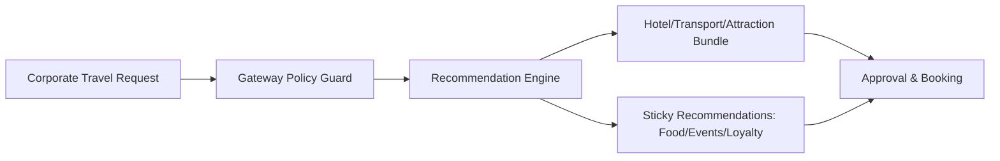
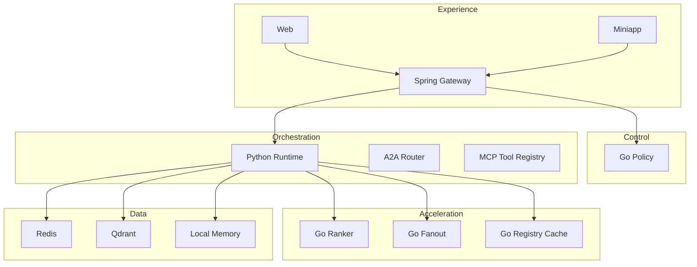
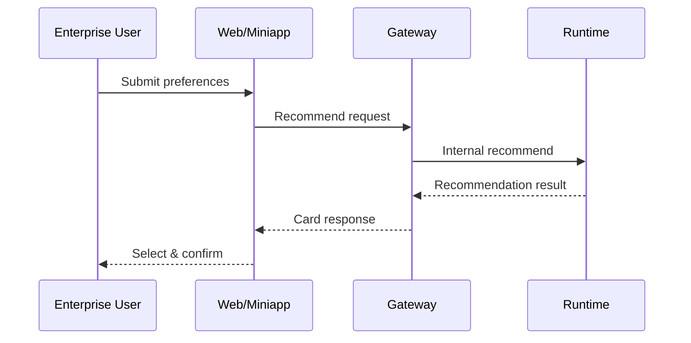

# Product Feature Manual (English)

Version: 2026-03-30

## 1. Product Positioning

An enterprise-grade travel recommendation platform for global B2B scenarios with strong governance, auditability, and extensibility.

## 2. Business Flow (Diagram)

## 2.1 Architecture Stack (Diagram)

## 3. User Journey (Diagram)

## 4. Feature Matrix (Table)

| Dimension | Capability | Notes |
| --- | --- | --- |
| Recommend | hotel/transport/attraction | core path |
| Sticky | food/events/loyalty | conversion & retention |
| Collaboration | multi-agent | Manager/RouteMaking/TripPlanner |
| Governance | policy checks | engine/tool limits |
| Memory | multi-backend | memory/Redis/vector/rocksdb |

## 4.1 Decision Rationale (Detail)

| Feature | Options | Final Choice | Rationale | Evidence |
| --- | --- | --- | --- | --- |
| Multi-agent | single agent vs multi-agent | multi-agent | separation of responsibilities | `services/techgroup-enterprise-travel-runtime/src/travel_agent/agents/*` |
| Tool registry | direct calls vs MCP | MCP | auditable tool calls | `services/techgroup-enterprise-travel-runtime/src/travel_agent/mcp/registry.py` |
| Memory | memory-only vs multi-backend | multi-backend | flexible storage | `services/techgroup-enterprise-travel-runtime/src/travel_agent/memory/*` |

## 5. Operations & Governance

- Audit trails: tool calls, A2A routing, policy decisions
- Canary gate + automated rollback
- Membership tiers: basic/silver/gold
- SLO tracking: p95/p99 latency, success rate, degradation

## 5.1 Optimization Roadmap

| Step | Objective | Change | Metric Impact |
| --- | --- | --- | --- |
| 1 | Control | Gateway policy checks | lower risk of invalid requests |
| 2 | Audit | MCP tool audit logs | traceable operations |
| 3 | Performance | Go Ranker/Fanout | p95 latency reduction |
| 4 | Scale | Registry cache | lower registry RTT |
| 5 | Global | multi-region deployment | higher availability |

## 6. Delivery Modes

- Web app and miniapp
- Docker Compose + K8s
- Teaching and evidence assets

## 6.1 Delivery Evidence (Snapshots)

Runtime API:

Gateway Policy Guard:

Go Ranker:

## 7. Metrics & SLOs (Table)

| Metric | Target | Notes |
| --- | --- | --- |
| Success rate | >= 99.9% | request success |
| p95 latency | < 450ms | critical path |
| Availability | 99.95% | monthly availability |

## 8. Globalization & Compliance

- Multi-region deployment and data boundary isolation
- Auditable logs and traceability
- IAM integration and secret management

## 9. Architecture Evolution & Optimization

### 9.1 Phased Evolution (Diagram)

### 9.2 Optimization Stages (Table)

| Phase | Goal | Key Optimization | Expected Outcome |
| --- | --- | --- | --- |
| P1 | Extensibility | Agent split + orchestrator | clearer flows |
| P2 | Auditability | MCP registry + audit logs | traceable ops |
| P3 | Governance | gateway policy + canary | controlled risk |
| P4 | Performance | Go ranker/fanout/policy | throughput boost |
| P5 | Global | multi-region active-active | SLA uplift |

## 10. Technology Choices

| Layer | Tech | Rationale |
| --- | --- | --- |
| Entry | Spring Gateway | enterprise policy control |
| Orchestration | Python Runtime | fast iteration + integration |
| Acceleration | Go Services | low latency + concurrency |
| Observability | Prometheus | mature metrics ecosystem |
| Storage | Redis/Qdrant | performance + multi-scenario |

## 10.1 Decision Rationale (Table)

| Concern | Choice | Reason |
| --- | --- | --- |
| Policy governance | Spring Gateway + Go Policy | clear separation of enforcement and execution |
| Fast iteration | Python Runtime | rapid feature delivery |
| High throughput | Go services | low latency in hot paths |
| Auditability | MCP + logs | compliance-ready tracing |

## 10.2 Selection Process (Steps)

1. Identify hot paths: scoring and policy checks under peak load.
2. Split services: scoring/policy/fanout as Go services.
3. Keep contracts: fields aligned with existing JSON.
4. Validate gains: shadow comparison and canary rollout.

### 10.2.1 Selection Evidence (Snapshots)

Runtime API:

Orchestrator:

## 11.4 Pattern-to-Implementation Map

| Pattern | Scenario | Evidence |
| --- | --- | --- |
| Strategy | policy decisions | `services/techgroup-enterprise-travel-policy-go/main.go` |
| Chain of responsibility | gateway checks | `services/techgroup-enterprise-travel-gateway/src/main/java/.../PolicyGuardService.java` |
| Factory | tool registry | `services/techgroup-enterprise-travel-runtime/src/travel_agent/discovery/*` |
| Observer | events/metrics | `services/techgroup-enterprise-travel-runtime/src/travel_agent/events/*` |

## 11. Design Principles & Patterns

### 11.1 Principles

- Single responsibility (agent/tool/policy separation)
- Minimal dependency with graceful fallback
- Audit-first design
- Progressive evolution with backward compatibility

### 11.2 Patterns

- Strategy pattern for policy decisions
- Factory for tool/registry instantiation
- Chain of responsibility for gateway checks
- Observer for event/metrics pipelines

## 11.3 Design Process Summary

1. Requirements: governance, audit, scale, multi-region.
2. Decomposition: gateway, runtime, tool registry, acceleration services.
3. Non-functional goals: latency, availability, traceability.
4. Iterative rollout: canary, shadow, rollback.

## 12. Standards Alignment

- Security: audit logs, least privilege, key rotation
- Reliability: SLO/SLA, degradation, rollback
- Globalization: multi-region, data boundary isolation
- Delivery: reproducible builds and change tracking

## 12.1 Standards Considerations

| Domain | References | Practical Alignment |
| --- | --- | --- |
| Security | ISO 27001, SOC 2 | audit logging, key rotation, least privilege |
| Privacy | GDPR, China PIPL | data boundary isolation, traceability |
| Reliability | SRE SLO/SLA | p95/p99 monitoring, rollback controls |

## 12.2 Standards in Practice

- Audit: MCP tool calls recorded with trace IDs.
- Security: internal signature and allowlist checks.
- Reliability: fallback to local engine on dependency failure.

## 13. gRPC Performance Assessment

Recommended gRPC usage for internal hot paths:

- Gateway -> Runtime
- Runtime -> Go Ranker/Go Policy

Public interfaces remain HTTP/JSON for low integration cost.

Detailed plan: `docs/grpc-migration-plan.en.md`

## 13.1 Implementation Evidence (Code Snapshots)

Runtime API:

Orchestrator:

Gateway Policy Guard:

Go Ranker:

## 14. Implementation Annotation Index (Mirrors Source)

- Runtime API: `services/techgroup-enterprise-travel-runtime/src/travel_agent/api/app.py`
- Orchestrator: `services/techgroup-enterprise-travel-runtime/src/travel_agent/orchestrator.py`
- Go Ranker: `services/techgroup-enterprise-travel-ranker-go/main.go`
- Go Policy: `services/techgroup-enterprise-travel-policy-go/main.go`
- Go Fanout: `services/techgroup-enterprise-travel-fanout-go/main.go`
- Registry Cache: `services/techgroup-enterprise-travel-registry-cache-go/main.go`

