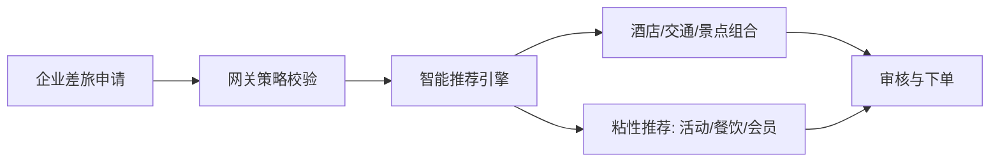
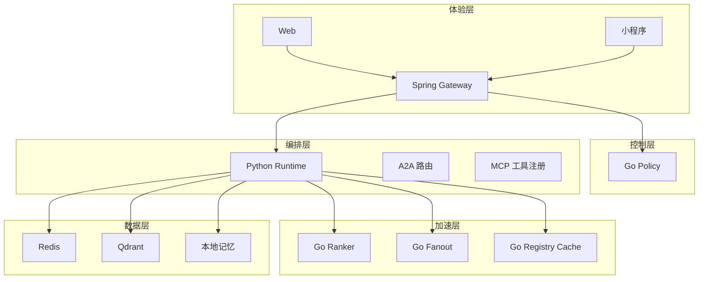
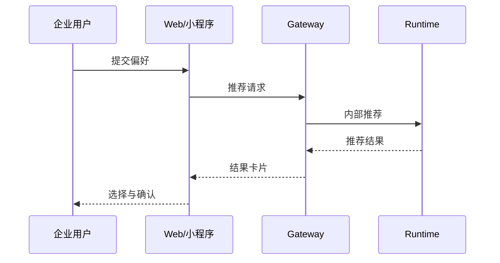
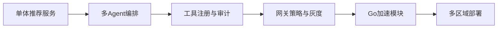

# 产品功能手册（中文）

版本：2026-03-30

## 1. 产品定位

面向全球化 B 端业务，提供可控、可审计、可扩展的企业级智能旅游推荐能力，支持多语言、多区域与跨域合规治理。

## 2. 业务场景（图）

## 2.1 架构分层（图）

## 3. 用户旅程（图）

## 4. 功能矩阵（表）

| 维度 | 能力 | 说明 |
| --- | --- | --- |
| 推荐 | 酒店/交通/景点 | 基础推荐链路 |
| 粘性 | 餐饮/活动/会员 | 增强转化与留存 |
| 协作 | 多 Agent | Manager/RouteMaking/TripPlanner |
| 治理 | 策略校验 | 引擎、工具、步数限制 |
| 记忆 | 多后端 | 内存/Redis/向量/rocksdb |

## 4.1 决策理由（详解）

| 功能 | 备选方案 | 最终选择 | 选择原因 | 证据 |
| --- | --- | --- | --- | --- |
| 多 Agent | 单体 vs 多 Agent | 多 Agent | 责任分离 | `services/techgroup-enterprise-travel-runtime/src/travel_agent/agents/*` |
| 工具注册 | 直连 vs MCP | MCP | 可审计 | `services/techgroup-enterprise-travel-runtime/src/travel_agent/mcp/registry.py` |
| 记忆后端 | 单一内存 vs 多后端 | 多后端 | 可扩展 | `services/techgroup-enterprise-travel-runtime/src/travel_agent/memory/*` |

## 5. 运营与治理

- 审计日志：工具调用、A2A 路由、策略决策
- 灰度门禁：canary gate + 回滚脚本
- 会员分级：basic/silver/gold 规则差异
- SLA 监控：p95/p99、成功率、降级次数

## 5.1 优化路径

| 阶段 | 目标 | 关键动作 | 指标影响 |
| --- | --- | --- | --- |
| 1 | 入口治理 | Gateway 策略校验 | 风险降低 |
| 2 | 审计闭环 | MCP 审计日志 | 可追溯 |
| 3 | 性能 | Go 加速模块 | 延迟下降 |
| 4 | 规模 | Registry Cache | 读取延迟下降 |
| 5 | 全球化 | 多区域部署 | 可用性提升 |

## 6. 交付形态

- Web 前端与小程序
- Docker Compose + K8s
- 教学与证据产物（PPT、视频、代码证据）

## 6.1 交付证据（截图）

Runtime API：

Gateway Policy Guard：

Go Ranker：

## 7. 指标与SLO（表）

| 指标 | 目标 | 说明 |
| --- | --- | --- |
| 成功率 | >= 99.9% | 推荐请求成功率 |
| p95 | < 450ms | 关键链路性能 |
| 可用性 | 99.95% | 月度可用性 |

## 8. 国际化与合规

- 多区域部署与数据边界隔离
- 审计日志与可追溯性
- 接入企业 IAM 与密钥治理

## 9. 架构演进与优化路径

### 9.1 阶段性演进（图）

### 9.2 优化阶段与收益（表）

| 阶段 | 目标 | 关键优化 | 预期收益 |
| --- | --- | --- | --- |
| P1 | 业务可扩展 | Agent 分工 + Orchestrator | 推荐结构清晰化 |
| P2 | 可审计 | MCP 工具注册 + 审计日志 | 合规可追溯 |
| P3 | 生产治理 | Gateway 策略 + Canary | 风险可控 |
| P4 | 性能 | Go Ranker/Fanout/Policy | 吞吐提升 |
| P5 | 全球化 | 多区域/多活 | SLA 提升 |

## 10. 技术选型说明

| 层级 | 技术 | 选型理由 |
| --- | --- | --- |
| 入口 | Spring Gateway | 企业接入与策略治理能力成熟 |
| 编排 | Python Runtime | 快速迭代 + 灵活集成 |
| 加速 | Go Services | 高并发 + 低延迟 |
| 观测 | Prometheus | 指标标准化与生态完善 |
| 存储 | Redis/Qdrant | 性能与多场景覆盖 |

## 10.1 选型理由（表）

| 关注点 | 选型 | 说明 |
| --- | --- | --- |
| 策略治理 | Gateway + Go Policy | 策略与执行解耦 |
| 迭代速度 | Python Runtime | 快速交付 |
| 高并发 | Go 服务 | 热路径低延迟 |
| 审计 | MCP + 日志 | 合规可追溯 |

## 10.2 选型过程（逐步）

1. 识别瓶颈：Python 评分与策略在峰值阶段成为热点。
2. 划分边界：将评分/策略/扇出拆为独立 Go 服务。
3. 定义契约：字段与现有 JSON 结构保持一致。
4. 验证收益：shadow 对比与 canary 逐步放量。

### 10.2.1 选型证据（截图）

Runtime API：

Orchestrator：

## 11.4 设计模式落地映射（表）

| 模式 | 场景 | 代码证据 |
| --- | --- | --- |
| 策略模式 | 策略决策 | `services/techgroup-enterprise-travel-policy-go/main.go` |
| 责任链 | 网关校验 | `services/techgroup-enterprise-travel-gateway/src/main/java/.../PolicyGuardService.java` |
| 工厂模式 | 工具注册 | `services/techgroup-enterprise-travel-runtime/src/travel_agent/discovery/*` |
| 观察者 | 事件与指标 | `services/techgroup-enterprise-travel-runtime/src/travel_agent/events/*` |

## 11. 设计原则与模式

### 11.1 设计原则

- 单一职责（Agent/工具/策略职责分离）
- 最小可依赖（可选后端、可降级）
- 可审计优先（日志与证据链）
- 渐进演进（兼容旧接口与配置）

### 11.2 设计模式

- 策略模式：策略决策与执行分离
- 工厂模式：工具与注册中心实例化
- 责任链：网关校验与策略过滤
- 观察者：事件总线与指标管道

## 11.3 设计过程摘要

1. 需求：治理、审计、扩展、多区域。
2. 拆分：网关、运行时、工具注册、加速模块。
3. 非功能目标：延迟、可用性、可追溯。
4. 渐进上线：canary、shadow、回滚。

## 12. 国内外规范对齐

- 安全合规：日志审计、最小权限、密钥轮换
- 可靠性：SLO/SLA 指标体系、降级与回滚
- 国际化：多区域部署、数据边界隔离
- 交付规范：可复现构建、版本与变更记录

## 12.1 规范对齐补充

| 领域 | 参考 | 对齐方式 |
| --- | --- | --- |
| 安全 | ISO 27001 / SOC 2 | 审计日志、密钥轮换 |
| 隐私 | GDPR / 个人信息保护法 | 数据边界隔离 |
| 可靠性 | SRE SLO/SLA | 监控与回滚 |

## 12.2 规范实践示例

- 审计：所有工具调用记录在 MCP 审计日志。
- 安全：内部请求签名与白名单校验。
- 可靠性：失败后 fallback 至本地引擎。

## 13. gRPC 性能评估

建议在内部高频链路引入 gRPC：

- Gateway -> Runtime
- Runtime -> Go Ranker/Go Policy

公开端仍保持 HTTP/JSON 以降低接入成本。

详细计划：`docs/grpc-migration-plan.zh.md`

## 13.1 实现证据（代码截图）

Runtime API：

Orchestrator：

Gateway Policy Guard：

Go Ranker：

## 14. 实现注释索引（与代码注释一致）

- Runtime API：`services/techgroup-enterprise-travel-runtime/src/travel_agent/api/app.py`
- Orchestrator：`services/techgroup-enterprise-travel-runtime/src/travel_agent/orchestrator.py`
- Go Ranker：`services/techgroup-enterprise-travel-ranker-go/main.go`
- Go Policy：`services/techgroup-enterprise-travel-policy-go/main.go`
- Go Fanout：`services/techgroup-enterprise-travel-fanout-go/main.go`
- Registry Cache：`services/techgroup-enterprise-travel-registry-cache-go/main.go`

