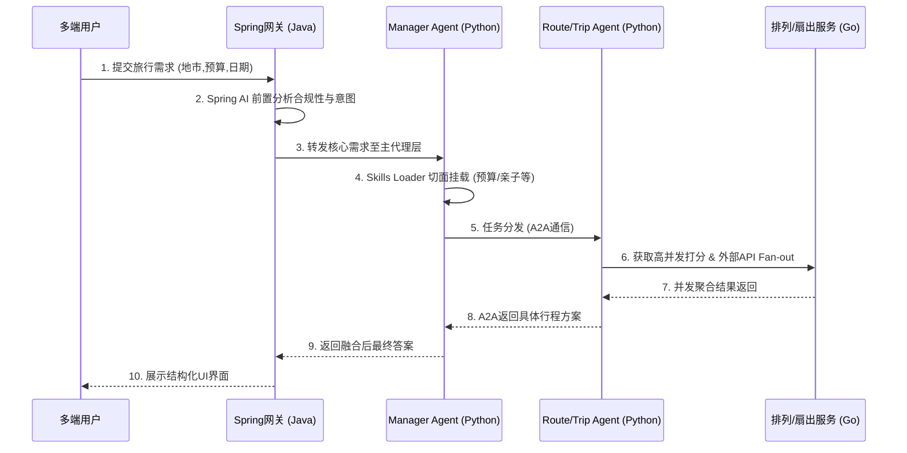
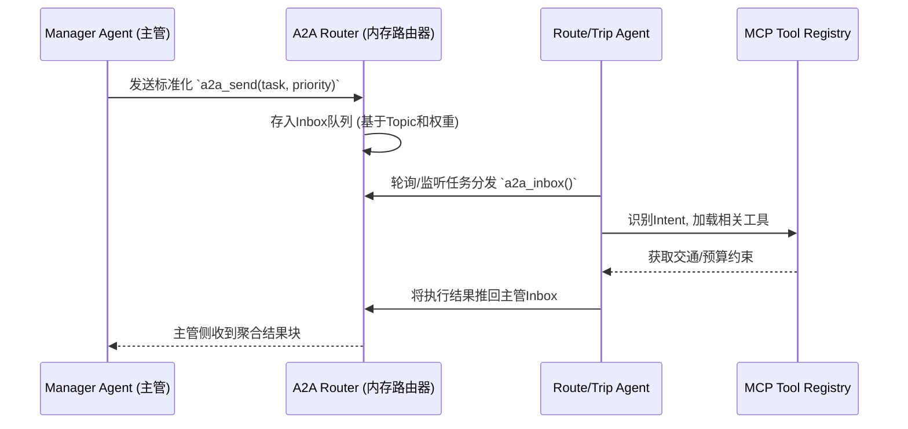
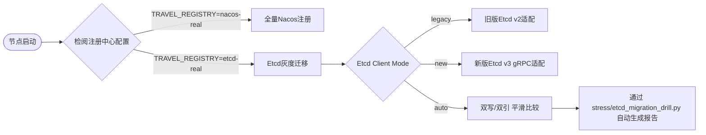
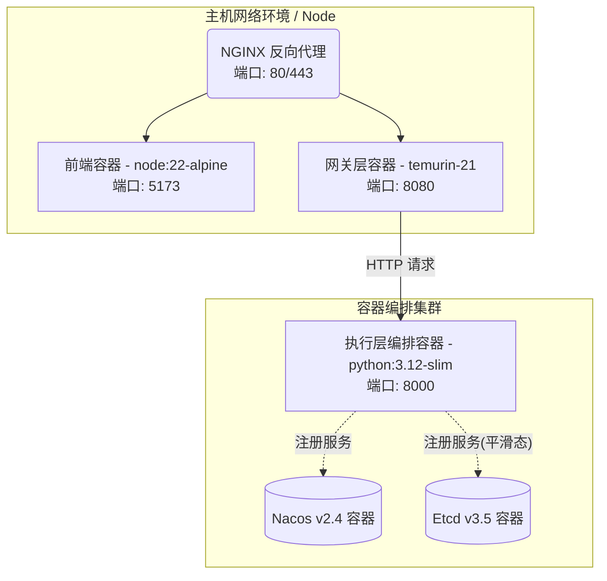
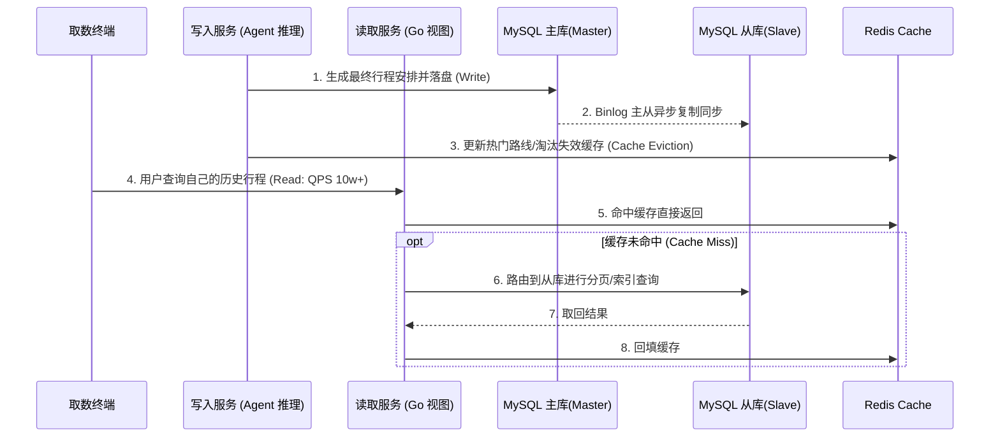

# 企业级智能旅游推荐智能体系统设计文档

## 1. 概述与核心需求

本项目是一个企业级智能旅游推荐多 Agent (Multi-Agent) 系统，采用微服务架构编排不同的 AI 及领域模型服务。旨在通过大型语言模型（LLM）的推理能力，协助用户完成复杂的旅行推荐与行程规划任务。

基于项目中的需求及演进过程，系统的核心需求及架构特性包括：
- **Agent多模型协同协同**：主 Agent (ManagerAgent) 负责流量接管与分析，统一分发任务给 RouteMakingAgent（路线规划）和 TripPlannerAgent（行程助手）。
- **A2A (Agent-To-Agent) 通信模型**：支持 Agent 之间的去中心化异步通信，通过注册中心（Nacos/Etcd）建立节点寻址发现模型。
- **MCP协议集成工具集**：对外围API（酒店、交通、景点等）封装为符合智能体调用标准（Tool/MCP）的服务入口。
- **混合式多语言架构**：网关层（Spring Cloud Gateway + Spring AI Alibaba）、编排执行层（Python Runtime）、高性能拓展组件集（Go Fanout, Policy, Ranker）。
- **动静结合的业务流**：支持基于前端 Web 以及微信小程序（Miniapp）的全渠道访问。
- **可观测性与生产可用**：具备完整的系统监控（Prometheus/Grafana），包含全链路追踪、灰度发布以及 Etcd/Nacos 注册中心的平滑迁移（Canary 放量）。

## 2. 总体系统架构

系统采用清晰的分层与微服务解耦设计。混合语言（Java、Python、Go）的采用旨在发挥各个语言栈在企业级应用中的独特优势。以下为系统的总体技术分层架构图：

```mermaid
graph TB
    subgraph 接入终端
        Web(React 19 Vite PC端)
        MiniApp(微信小程序)
    end

    subgraph 边界网关接入层 [接入层 API Gateway - Java/Spring]
        GW(Spring Cloud Gateway)
        Security(Spring Security + JWT)
        AIAdvisor(Spring AI Alibaba 意图分析)
        GW -.拦截.-> Security
        GW -.补全.-> AIAdvisor
    end
    
    subgraph 多Agent推理编排执行层 [执行层 Agent Runtime - Python]
        MA(Manager Agent<br>统筹与规划)
        RA(RouteMaking Agent<br>路线代理)
        TA(TripPlanner Agent<br>行程代理)
        Memory(VectorDB/RocksDB<br>长期知识与记忆)
        Skills(Skills Loader<br>专家技能池)
        
        MA --> RA
        MA --> TA
        MA --> Memory
        MA -.挂载.-> Skills
    end
    
    subgraph 高性能并行与算法服务层 [计算基建层 - Go]
        FanC(Go-Fanout<br>高并发工具聚合)
        Rank(Go-Ranker<br>加权排序引擎)
        Policy(Go-Policy<br>OPA安全拦截)
        Cache(Go-Registry-Cache<br>多服务二级缓存)
    end

    subgraph 注册与配置中心 [数据与治理中心]
        Nacos[(Nacos 集群<br>注册发现的主备节点)]
        Etcd[(Etcd 灰度迁移节点<br>支持双栈客户端)]
        Monitor(Prometheus & Grafana)
    end
    
    接入终端 ==> GW
    GW ==HTTP/mTLS==> MA
    GW -.授权钩子.-> Policy
    RA -.MCP工具调用.-> FanC
    RA -.打分回调.-> Rank
    
    MA -.服务寻址.-> Nacos
    FanC -.服务寻址.-> Nacos
    Nacos <..> Cache
    Etcd <..> Cache
```

各层职责与技术细节如下：

### 2.1 表现层与接入层
- **多端触达**：
  - `apps/techgroup-enterprise-travel-web/`：基于 React 19/Vite 构建的 SPA 应用，提供在 Web 端直观的交互与基于卡片的推荐结果展示。
  - `miniapp-wechat/`：微信小程序原生实现，基于事件绑定与页面栈控制，触达更多移动用户。
- **API 网关 (`techgroup-enterprise-travel-gateway/`)**：
  - **技术科普：Spring Cloud Gateway (Java)**：底层基于 Project Reactor 实现的非阻塞式 (Non-blocking) WebFlux 响应式框架，天生适合处理高并发和长连接，并能在网关层面做限流、熔断。在 `PythonRuntimeClient.java` 的实现中，通过构建 `X-Trace-Id`、`traceparent` 透传 OpenTelemetry 兼容的全链路 ID，并采用 `X-Internal-Signature` 进行基于 mTLS （IdempotencyKey签名）的防串改校验。
  - **Spring AI Alibaba**：网关集成了 Spring AI 框架，前置提供简单意图的 AI 拦截与 Advisor 过滤。例如通过简单的 Java 链式调用就可以实现大模型的基础补全能力，降低后方 Python 核心智能体的负载。

### 2.2 编排引擎与多 Agent 平台 (`src/travel_agent/`)
基于 Python Runtime 构建核心的 Agent 推荐平台：
- **技术科普：Python 与 Agent 框架**：Python 凭借其极度活跃的 AI 生态（LangChain, LlamaIndex 等）成为了 LLM 开发的事实标准。在我们的系统里，使用 Python 构建了 Agent 的记忆挂载、Prompt 路由与 A2A 编排中心。
- **Supervisor / ManagerAgent**：统筹规划，负责 Prompt 拆解与多技能加载。
- **Worker Agents / A2A 通信协议**：
  - `RouteMakingAgent`：专司路线生成与交通/酒店组合模型分析。
  - `TripPlannerAgent`：专注于每日的景点编排与停留时间管理。
  - Agent 之间使用轻量化 `a2a/protocol.py` 协议互通，并由虚拟路由于内存或 RPC 直接派送任务。
- **Skill Loader (`skills/loader.py`)**：动态加载 JSON 格式的专业技能集（针对家庭旅游、预算优先、高舒适度等场景），通过权重系数融合，干预推荐排序逻辑。
- **多种记忆组件实现 (`memory/`)**：
  - 提供多后端：InMemory、Redis (`redis_store.py`)、RocksDB (`rocksdb_store.py`) 以及用于意图搜索的本地向量库检索机制 (`vector_store.py`)。

### 2.3 高性能后备与并发服务层 (Go 组件集群)
针对高吞吐量与性能的关键节点，系统抽离并使用 Go 处理。
**技术科普：Go语言基础**：Go 以 Goroutine（轻量级协程）与 Channel（管道通信）为核心竞争力。它可以轻松启动十万级规模的协程进行并发任务，因此在处理大量计算和多路 I/O 扇出的场景下具备极低资源消耗与极高吞吐率。
- **`go-fanout`**：实现高可用多引擎并行请求及结果扇出（Fan-out 模式）。它可以一条请求变多路并发获取各个平台机票与酒店价格，等待全部就绪后返回。
- **`go-ranker`**：对接 Python 端的推荐池，针对多维度分值（价格、舒适度、距离）配合 Skills 的权重机制进行高性能并行重排 (Re-ranker)。
- **`go-policy`**：基于 OPA (Open Policy Agent) 与 Rego 规则引擎的安全拦截组件。判断是否超预算、含有违规地点及拦截危险 Prompt，并在网关/Agent中间作为钩子执行。
- **`go-registry-cache`**：结合 Nacos 与 Etcd，进行服务列表与配置的高速本地二级缓存。

### 2.4 底层配置与注册发现机制
针对大规模服务，系统实现并支持了：
- **注册发现中心**：默认接入 `RealNacosRegistry`，演进中支持 `RealEtcdRegistry` 进行管理，Agent与微服务节点启动即注册。
- **注册中心平滑迁移**：支持双写/双引的双栈 Etcd 客户端，并通过灰度打流 (`stress/etcd_migration_drill.py`) 验证兼容性与数据一致性。

## 3. 核心业务流程与交互时序图

典型的端到端旅游推荐调用流程如下时序图所示：



### 详细步骤说明：
1. **意图交互**：用户通过微信小程序或 Web 端提交旅游请求（例如“上海出发，杭州3日亲子游，预算5000元”）。
2. **网关过滤**：流量命中 `techgroup-enterprise-travel-gateway`，经过 Go-Policy (`go-policy`) 审核输入数据合规，确认无可疑 Prompt 注入且符合旅行代理范畴。
3. **记忆构建 / Skills 切点**：ManagerAgent 拦截到对话请求（读取 `conversationId`），如果曾有历史聊天，则从 Redis / VectorStore 中拉取。随后 `Skills Loader` 动态挂载 `family.skill.json` 以及 `budget.skill.json`。
4. **任务裂变 (Manager Agent -> Worker)**：
   Manager Agent 使用 A2A 协议分发到 RouteMakingAgent 与 TripPlannerAgent 两个工作流节点同步执行：
   - Route Agent 运用 MCP 调用交通 API（查询航班/高铁）和酒店库，并将初步组合交付给 `go-ranker` 进行“家庭+预算”维度的复合加权打分返回。
   - Trip Agent 使用景点数据组织完整的出行分日大纲。
5. **聚合同步与最终输出**：Manager 层将各个推荐组件的数据进行融合润色后封装给客户端，记录审计日志至 RocksDB 中。

## 4. 模块处理流程详情与底层细节

为了支撑上述宏大的分层系统，底层运用了大量行业最佳实践以保证高可靠和稳定性。

### 4.1 A2A 协议与 Python 多进程协同

系统中 Agent 间通信未使用传统的硬编码 RPC，而是采用了面向智能体的 **A2A (Agent-To-Agent) 协议** (`a2a/protocol.py`)：


- **核心逻辑**：基于 Inbox 模型在 Python 内部以协程(Coroutine)级别调度，未来可平滑迁移至 Kafka 或 RabbitMQ 队列实现跨网络 Agent 寻址。
- **Python执行引擎科普**：利用 Python 3.12 引入的高效异步及 `uvicorn` 高性能模型将系统从串行流释放。配合 `Pydantic` 进行严格的数据类校验，确保大模型吐出的非结构化 JSON 可以强制转为代码可用类对象。

### 4.2 流量灰度与 Nacos/Etcd 双栈平滑迁移机制

企业级项目经常面临基础设施的演进。在 `travel-agent-api` 启动时，项目通过配置环境变量 `TRAVEL_ETCD_CLIENT_MODE=legacy|new|auto` 支持跨不同注册发现组件的无缝降级：


- **技术打磨细节**：
  这种灰度与打流设计极大保证了系统的生产稳定性。双写状态下，路由组件在发现节点时，会默认优先查询主仓库（Nacos），异步对比 Etcd 的拉取结果。如果不一致则记录日志(`Canary 放量报警`)，帮助 SRE（运维团队）在流量巅峰期前洞察状态同步问题。

## 5. 生产级部署与容器架构

微服务的工程离不开云原生基建，采用 Docker 与 Kubernetes/Kustomize 相得益彰：



- **部署细节知识科普**：
  - 在 `platform/deploy/docker-compose.yml` 中，`travel-agent-api` 并行支持安装了 `requirements-etcd-legacy.txt` 和 `requirements.txt` 以验证平滑替换实验的正确性。
  - 网关 `techgroup-enterprise-travel-gateway` （运行于 `temurin-21`，Java 21具备强劲的虚拟线程特性，能巨幅提升IO吞吐）利用 `depends_on` 控制了容器拓扑的启动顺序。

## 6. 系统性能评估与可观测性保障

- **系统性能评估**：通过 `stress/` 目录下的压测脚本以及 Locust / Pytest 进行大规模并发打流测试（支持 `report_5k.json` 并发级别性能观测验证）。
- **分布式配置与迁移灰度**：支持 Canary 部署，并在 `docs/canary-etcd-migration-report-template.md` 与上线 Checklist 中记录了高危切换方案的核心步骤。
- **持续集成与容器编排**：各组件均包含优化过的 `Dockerfile`，并拥有配套的 `platform/deploy/docker-compose.yml` 与 `k8s/` Kubernetes YAML 资源文件，形成标准的企业级部署闭环。

## 7. 架构扩展与演进方向

依据现有框架对未来技术架构提供建议（参考 `go-expansion-guide.md`）：
- 全面接入 OpenTelemetry 完成跨语种全链路 TraceID 的上下文透传。
- 采用 gRPC 替代或协同现成 HTTP/A2A 消息机制，对长链路（Python Manager $\leftrightarrow$ Go Ranker/Fanout）进行进一步的提速与协议精简。
- 引入外围云服务的深度集成，如使用阿里云大模型应用中心与更广义的 MCP 工具（外卖服务、打车接口、景区排队查询等）的动态发现。

## 8. 万级并发与亿级用户数据架构设计 (高并发/高可用演进核心)

随着企业用户量攀升至 1 亿、平台长连接或瞬时并发流量（如节假日旅游抢票、路线密集规划）突破百万级别 (100W CCU)，现有主要以文件、内存及单节点依赖的系统必须朝着**核心分布式、重度分库分表、计算/存储隔离**的架构跃迁。上述架构为容量规划目标（目标口径，非实测结论）；是否达到上市生产标准须以真实分布式压测与故障演练证据为准（见 stress/ 目录证据链与 global_scale_readiness 报告）。

### 8.1 核心数据存储矩阵架构 (Storage Architecture)

为支持业务特征，系统采用典型的 "**Polyglot Persistence (多语言/混合持久化)**" 模型：

```mermaid
graph TD
    subgraph SL["接入层与计算层 (Stateless)"]
        GW[Spring API Gateway]
        PYCore[Python Agent Runtime]
        GOSvc[Go 并发聚合服务]
    end

    subgraph RDBMS["联机事务存储 - 用户资产与核心订单"]
        Proxy([ShardingSphere-Proxy 分布式数据库中间件])
        DB1[(MySQL 节点1 - Hash / 分库)]
        DB2[(MySQL 节点2 - Hash / 分库)]
        DB3[(MySQL 节点3 - Hash / 分库)]
        Proxy --> DB1 & DB2 & DB3
    end

    subgraph CACHE["NoSQL/Cache层 (热数据/会话状态/高并发承载)"]
        Redis[(Redis Cluster <br> 16分片/主从复制)]
        RocksDB[(全闪存 NVMe Local RocksDB <br> 节点级本地高速缓存)]
    end

    subgraph 向量与多模态存储中心 (RAG基建)
        Milvus[(Milvus 向量数据库集群 <br> 支撑海量城市POI和攻略语义搜索)]
        OSS[(对象存储 OSS/S3 <br> 存储音频/用户头像/旅游相册/文档)]
    end
    
    subgraph Data Lake (离线与数仓)
        Kafka([Kafka 分布式消息队列])
        ClickHouse[(ClickHouse 大数据分析/日志)]
    end

    GW -->|高频用户凭证校验| Redis
    PYCore -->|对话上下文写入| Redis
    PYCore -->|意图匹配与知识库| Milvus
    PYCore -->|订单/行程入库落盘| Proxy
    GOSvc -->|高频外部API聚合| RocksDB
    PYCore -. "审计与A2A流水账" .-> Kafka
    Kafka --> ClickHouse
```

### 8.2 关键存储组件职能分配

1. **关系型数据库 (MySQL/TiDB)**：
   - *演进优化*：摒弃原有的纯内存/本地 JSON 获取数据。单表超千万级时通过 Apache ShardingSphere 对 `users` (按 Hash) 与 `trip_plans` (按行程时间或用户ID) 进行分库分表操作。
   - *落地实现*：已提供初始数据字典和分表概念脚本 -> 见 `deploy/db/schema.sql`，保证数据的一致性与 ACID。
2. **高速缓存集群 (Redis Cluster)**：
   - *功能*：支撑多轮 Agent 对话的短期或正在活跃的记忆 (Conversation Memory)、JWT Token 会话状态维持、防止系统过载的全局限流计数器 (Rate Limiter)。
   - *优化*：为保障 100W 并发不把 DB 击穿，需配置 Redis Cluster（推荐 10-20 个以上的数据分片）配合布隆过滤器对抗缓存穿透。
3. **本地近源缓存 (RocksDB)**：
   - *功能*：在 Python ManagerAgent 与 Go-Ranker 节点中用于极高频次（毫秒级命中）且不轻易变更的热门旅游地数据、路线缓存（如西湖、故宫）。
   - *优势*：纯 SSD 磁盘 I/O，不占用宝贵网传带宽。
4. **向量数据库与语料库 (Milvus)**：
   - *功能*：承担千万级别规模的景点评论、城市游记的向量 Embedding 存储，赋能 TripPlanner Agent 执行基于 RAG（检索增强生成）的相关性事实问答。
5. **对象存储体系 (S3/OSS + CDN)**：
   - *功能*：剥离 `assets/` 本地目录，平台所有旅行攻略图、头像、行程生成文档 (.pptx/.pdf) 统一交于云端 OSS 对象存储托管，并通过 CDN 回源进行前端全球加速，极大优化首页加载速度。

### 8.3 数据访问与读写分离模式 (CQRS 设计)

针对高并发流量，执行**命令查询职责分离 (CQRS)**：



### 8.4 上线部署架构规划 (大运版本支撑 1 亿数据盘)

为达到百万并发并稳妥上市，在 `platform/deploy/` 下可按需增加 Terraform 资源编排方案。其物理架构规划如下：

1. **外网与安全**：启用商用 WAF 防火墙过滤僵尸网络和恶意 Prompt 攻击，之后到达企业级 CLB（云负载均衡引擎）。
2. **多活 / 异地容灾调度 (Multi-Region / Multi-Zone)**：系统采用 Kubernetes 进行底座支撑，部署至“两地三中心”。当某一机房（同城双活）网关崩溃（比如 A 区 `Spring Gateway` 拥堵），通过 Nacos 流量路由能瞬间倾斜至 B 区算力池。
3. **弹性伸缩 (HPA)**：在旅游淡旺季（如法定长假放假前夜的爆发），K8s HPA 会根据 Prometheus Metrics (如 `request_queue_length` 和 `agent_token_consumption_rate`)，自动水平扩容 `go-fanout` 与 `python-runtime` 容器。
4. **数据库灾备**：开启基于行级 Binlog 实时抽取至数仓 (ClickHouse/Hive) 留存，既用作分析，又能够在面临毁灭级别的攻击后进行点级恢复。
